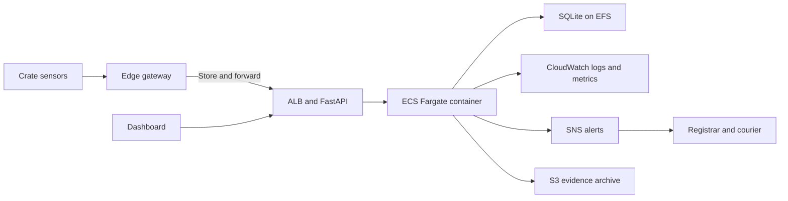

# CrateWatch

CrateWatch is a condition-monitoring prototype for fine art shipments. It records temperature, humidity, shock, door state, and battery readings for six simulated crates. Threshold rules open incidents, and the API records acknowledgement and resolution times for SLA and TTR reporting.

This project was built for the Cloud Computing mini project. It covers AWS, Docker, virtualization, SLA, and TTR, with a working local demo and a measured test report.

Repository: <https://github.com/himadri991/CrateWatch->

## Why this problem

Condition checks at pickup and delivery leave long gaps during transport. A shock, heat spike, or open door may go unrecorded until arrival. CrateWatch keeps a timestamped record during transit and links a breached reading to an incident and its recovery time.

## What the system does

- Ingests crate telemetry every two seconds through a batch API.
- Buffers readings in a local SQLite store when the network is down, then flushes them after recovery.
- Applies threshold rules for shock, temperature, humidity, door state, battery, and telemetry gaps.
- Opens incidents with severity S1 to S4 and sends alerts to logs, a webhook, or Amazon SNS.
- Tracks the incident lifecycle from OPEN to ACK to RESOLVED.
- Computes availability, alert latency, API latency, ingestion delay, and TTR.
- Shows a live dashboard with fleet status, incident queue, trends, and SLA checks.
- Exports telemetry and incidents as CSV, and can archive both to Amazon S3.

## Architecture



The local prototype runs the same application code without AWS. The Terraform stack maps the same design to ECS Fargate, ALB, ECR, EFS, S3, CloudWatch, SNS, Secrets Manager, IAM, and VPC.

## Measured results

These numbers come from local runs on an Apple M2 machine. They are not AWS deployment measurements. The full evidence is in [docs/TEST_EVIDENCE.md](docs/TEST_EVIDENCE.md).

| Item | Result |
| --- | --- |
| Functional test suite | 25 tests passed |
| Telemetry availability, 15 minute window | 100.00 percent |
| Alert latency P95 | 0.00 s |
| API latency P95 under load | 121.81 ms |
| API latency P99 under load | 257.56 ms |
| Throughput | 330.20 requests/s |
| Readings accepted in load test | 5030 |
| Error rate under load | 0.000 percent |
| Controlled S1 TTR | 4.031 s, or 0.067 min |
| RTO after process termination | 2.48 s |
| Edge buffer recovery | 6 readings buffered, 6 recovered, 0 lost |

The load run also measured P95 latency of 947.60 ms for `/api/sla`, above its 300 ms target. Other API requests met the target in that run. The report records this as a query optimization task.

The SLA endpoint aggregates the rolling window. Its P95 reached 947.60 ms under synthetic load. The dashboard polls it every two seconds. Caching or pre-aggregation is needed before increasing that polling rate.

## Quick start

```bash
make install
make test
make run
```

Open http://127.0.0.1:8000 in a browser.

In a second terminal, start the edge simulator:

```bash
make simulate-mixed
```

In a third terminal, run the recovery scenario and the load test:

```bash
make ttr
make load
make gap
make report
make style
make terraform-check
```

The default demo token is `local-demo-token`. Change it in `.env` or the environment before using the app outside a local demo.

## Demo flow

1. Open the dashboard and confirm six crates are online.
2. Use the demo controls to inject a 12.4 g shock on CW-03.
3. The incident queue shows an S1 incident. The crate card turns CRITICAL.
4. Click Acknowledge, then Resolve. The dashboard updates the TTR.
5. Open the SLA panel to see the rolling checks.
6. Run `make load` to produce the latency and throughput evidence.
7. Run `make gap` to see the API outage scenario, edge buffering, gap detection, and zero data loss.
8. Run `make report` to rebuild the evidence file.

## AWS deployment

The Terraform stack is in `infra/terraform`. It provisions:

| Service | Role |
| --- | --- |
| ECS Fargate | Runs the FastAPI container |
| Application Load Balancer | Public entry point and health checks |
| ECR | Stores the container image |
| EFS | Persistent SQLite volume for the prototype |
| S3 | Evidence archive with versioning and encryption |
| CloudWatch | Logs, metrics, alarms, and an S1 incident filter |
| SNS | Incident and alarm notifications |
| Secrets Manager | Admin token, injected into the task |
| IAM and VPC | Least privilege roles, public subnets, security groups |

See [docs/AWS_DEPLOYMENT.md](docs/AWS_DEPLOYMENT.md) for the build, push, deploy, and teardown steps.

## Repository layout

```text
app/                            FastAPI application, rules, SLA logic, dashboard
edge/                           Edge telemetry simulator with a store-and-forward buffer
scripts/                        TTR, load, RTO, gap, report, style, and PPT scripts
tests/                          Unit and API tests
docker/                         Dockerfile, Compose file, and Docker ignore rules
infra/terraform/                AWS infrastructure as code
infra/monitoring/               Prometheus scrape configuration
docs/                           Architecture, SLA, runbook, test evidence, and context notes
```

## Limitations

- The measured numbers come from the local runtime. A live AWS deployment was not run because no AWS credentials were provided.
- The Terraform HCL files parse with a local HCL parser, but `terraform validate` and a live apply were not run.
- A local Docker build was not run because no container runtime is installed on the build machine. The Dockerfile and Compose file are included.
- SQLite on EFS works for a single ECS task. Horizontal scaling needs PostgreSQL, Aurora, or DynamoDB.
- The demo admin token is visible to the dashboard when demo mode is on. Keep demo mode off in a public deployment.
- The SLA aggregate endpoint needs caching or a pre-aggregated table before it can handle sustained dashboard polling at high load.
- The local demo uses simulated sensor data. Real deployments need calibrated sensors and a device provisioning process.

## Project status

This is a course prototype. A live AWS deployment and Docker build were not run. Review the security and compliance requirements before using it with real shipments.
