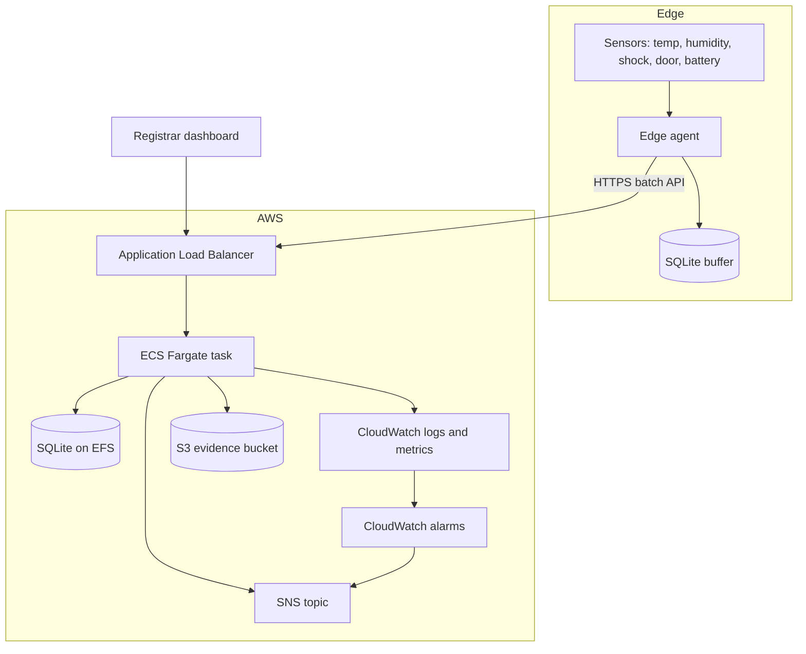

# CrateWatch Architecture

## System boundary

CrateWatch covers the path from a crate sensor to a registrar or courier who must act on an alert. The system starts at the edge gateway and ends at the dashboard, the alert channel, and the evidence archive. Sensor hardware, courier mobile apps, and insurance claim systems are outside this prototype.

## Component view



## Components

| Component | Responsibility | Main file |
| --- | --- | --- |
| Edge agent | Reads sensor values, assigns sequence numbers, buffers unsent batches, retries after recovery | `edge/agent.py` |
| API service | Validates telemetry, stores readings, runs rules, manages incidents, serves the dashboard and SLA data | `app/main.py` |
| Rules engine | Converts threshold breaches and telemetry gaps into incidents | `app/rules.py` |
| Alerting | Writes structured alert logs, calls an optional webhook, and publishes to SNS when configured | `app/alerts.py` |
| SLA engine | Computes availability, alert latency, API latency, ingestion delay, and TTR | `app/sla.py` |
| Database | Stores crates, telemetry, incidents, and shipment events | `app/db.py` |
| Dashboard | Shows fleet status, incident queue, trends, SLA checks, and demo controls | `app/templates/dashboard.html`, `app/static/app.js` |
| Metrics | Exposes Prometheus counters, gauges, and histograms | `app/metrics.py` |
| Evidence export | Writes telemetry and incident CSV files to S3 | `app/main.py` |

## Data flow

1. The edge agent reads a simulated sensor sample for each crate every two seconds.
2. The agent assigns a per-crate sequence number and posts a batch to `/api/telemetry/batch`.
3. The API validates the payload, rejects duplicate sequence numbers, and writes the reading to SQLite.
4. The rules engine checks the reading against the thresholds for shock, temperature, humidity, door state, and battery.
5. A breach creates or reuses an open incident for the same crate and rule, then writes an alert record.
6. The alert layer writes a structured log line. If configured, it also posts to a webhook and publishes to SNS.
7. A background loop checks for telemetry gaps and opens an S3 incident when a crate is silent for too long.
8. The dashboard polls `/api/fleet`, `/api/incidents`, and `/api/sla` every two seconds.
9. A registrar acknowledges and resolves the incident. The API records the timestamps used to compute TTR.
10. The evidence export endpoint writes telemetry and incident CSV files to S3 with server side encryption.

## Telemetry payload

```json
{
  "crate_id": "CW-03",
  "shipment_id": "SHP-2026-11-07-01",
  "seq": 1482,
  "event_ts": "2026-11-07T10:15:30.000Z",
  "temp_c": 21.4,
  "humidity_pct": 48.2,
  "shock_g": 12.4,
  "door_open": false,
  "battery_pct": 87.0
}
```

## Incident model

| Field | Meaning |
| --- | --- |
| `rule_id` | Rule that opened the incident, for example `SHOCK_LIMIT` |
| `severity` | S1, S2, S3, or S4 |
| `status` | OPEN, ACK, or RESOLVED |
| `event_ts` | Time the condition occurred at the crate |
| `detected_at` | Time the API opened the incident |
| `ack_at` | Time an operator acknowledged the incident |
| `recovered_at` | Time the condition returned to normal |
| `resolved_at` | Time an operator closed the incident |
| `ttr_seconds` | Resolved time minus event time |

## Failure paths

### API outage

The edge agent cannot post a batch. It stores the batch in its local SQLite buffer and keeps the sequence number. After the API returns, the agent flushes the buffer in order. The API rejects duplicates by sequence number, so a retry does not create duplicate evidence. The gap rule opens a telemetry gap incident. The gap demo showed 6 readings buffered, 6 recovered, and 0 lost.

### Edge agent outage

The API sees no readings from a crate. The gap rule opens an S3 incident after the gap threshold. When the agent restarts, it resumes from its persisted sequence number. The dashboard shows the gap incident until the crate reports again.

### API process crash

The container or process restarts. SQLite with WAL recovers on startup. The load balancer health check removes an unhealthy task from rotation. The RTO demo measured 2.48 seconds for a local process restart and confirmed that a marker reading survived the restart.

### Alert channel failure

The alert layer catches webhook and SNS errors and logs them. The incident remains in the database, so the dashboard still shows it. The alert is not marked as delivered. A production system should add a retry queue and a dead letter topic.

### S3 unavailable

The evidence export returns HTTP 502 with the storage error. Telemetry and incident data remain in SQLite. The operator can retry the export after the bucket or IAM policy is fixed.

### Database unavailable

The API cannot serve or store data. The ALB health check fails and the task is replaced. The current prototype does not run a second task because SQLite on EFS allows only one writer. A production design should use Aurora or DynamoDB and a multi-task service.

## AWS mapping

| Local component | AWS service | Notes |
| --- | --- | --- |
| FastAPI process | ECS Fargate | One task in the prototype, 0.5 vCPU and 1 GB memory |
| Local SQLite file | EFS access point | Single writer, persistent across task restarts |
| Local Docker image | ECR | Image tagged with the release version |
| Local HTTP port | Application Load Balancer | Health check on `/healthz` |
| Local log file | CloudWatch Logs | Log group per environment |
| Local metrics | CloudWatch metrics and alarms | S1 incident filter and ALB 5xx alarm |
| Local webhook/email stub | SNS | Email or HTTPS subscription |
| Local CSV export | S3 | Versioning, AES256 encryption, public access blocked |
| Local environment file | Secrets Manager | Admin token stored as a secret |
| Local network | VPC with two public subnets | Prototype only, private subnets recommended for production |

## Security boundaries

- The ALB is the only internet-facing component when trusted CIDRs are configured. The Terraform default allows no inbound CIDRs.
- The ECS task runs with a dedicated execution role and task role.
- The task role can write to the evidence bucket and publish to the alert topic.
- The admin token is stored in Secrets Manager and injected into the task.
- S3 public access is blocked and default encryption is enabled.
- Demo mode is disabled by default in Terraform.
- The prototype does not include a WAF, a custom domain, or user authentication. Those are required before a public production launch.

## Observability

- `/healthz` for load balancer health checks.
- `/metrics` for Prometheus and CloudWatch Container Insights.
- Structured JSON alert lines in CloudWatch Logs.
- A metric filter counts S1 alert lines and an alarm fires when the count is above zero.
- An ALB 5xx alarm fires when the target returns server errors.
- The dashboard shows the rolling SLA snapshot and the incident queue.

## Scaling limits

- One ECS task is the safe limit with SQLite on EFS.
- The `/api/sla` endpoint scans the rolling window on every request. It needs a cache or a pre-aggregated table before sustained high traffic.
- The edge buffer is per agent. A fleet with many gateways needs a device registry and per-device credentials.
- There is no multi-region failover. A production design needs a multi-AZ database and a recovery region.

## What was not tested

- A live AWS deployment, because no AWS credentials were provided.
- A local Docker build, because no container runtime was installed on the build machine.
- Real sensor hardware and network conditions.
- Multi-task concurrency and database failover.
- Load above 32 concurrent clients.
